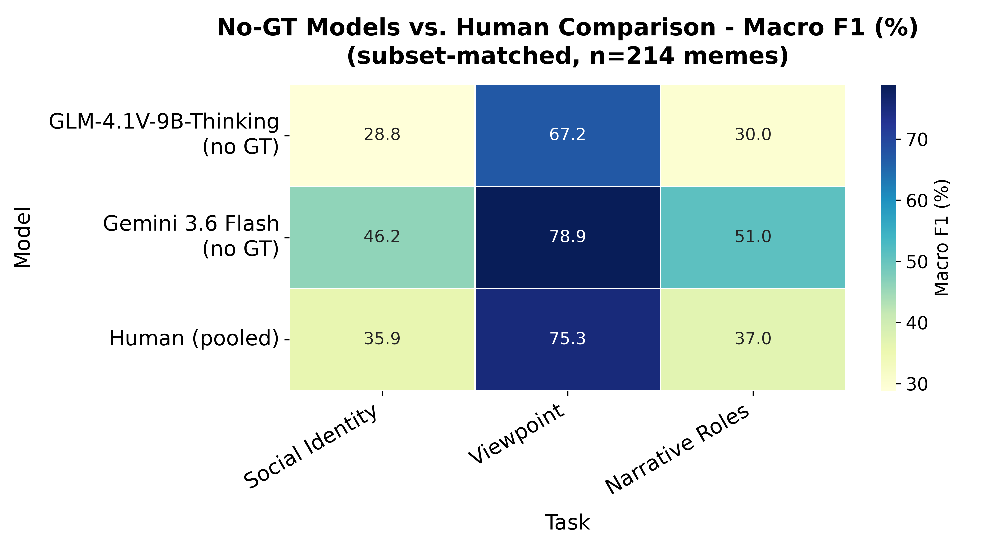

# No-ground-truth runs vs. human evaluation

GLM-4.1V-9B-Thinking and Gemini 3.6 Flash run through the three-step pipeline
**without any ground truth in the prompts**, compared against the human
annotators. Neither the models nor the annotators see the ground truth, so
this is the like-for-like comparison. The GT-conditioned VLM runs
(`benchmark/results/metrics/gt_conditioned/`, and the original Gemini run in
`benchmark/results/raw/gt_conditioned/gemini-3.6-flash/`) give the model the true
identities, which the annotators never had, and are therefore not comparable
to the humans.

| Step | GT-conditioned runs | These runs (no GT) |
|---|---|---|
| 1. Social identities | image only | image only |
| 2. Viewpoints | GT identities | identities predicted in step 1 |
| 3. Narrative roles | GT identity + viewpoint pairs | identity + viewpoint pairs predicted in step 2 |

The prompts (`src/experiments/inference/prompts/01-03_*.txt`) are identical in all runs;
only the values filled into `{social_identities}` and `{viewpoints_context}`
differ.

## Results: no-GT models vs. humans, same 214 memes

The humans labeled 215 scorable memes when this comparison was built; 214 of
them also have a prediction from both models, and every number below is
scored on exactly those 214 memes with the
same scoring code (`format_predictions.py` / `evaluate.py`). Values are
percentages; differences are computed from unrounded values.

### Headline (Micro F1)

| Task | Human (pooled) | GLM, no GT | Gemini, no GT | GLM − Human | Gemini − Human |
|---|---:|---:|---:|---:|---:|
| Social Identity | 57.4 | 44.5 | 62.1 | -12.9 | +4.7 |
| Viewpoint | 78.9 | 73.3 | 82.5 | -5.5 | +3.6 |
| Narrative Roles | 47.4 | 39.1 | 56.4 | -8.3 | +9.0 |
| All Combined | 60.5 | 51.0 | 65.9 | -9.5 | +5.4 |



### All flat-set metrics

| Task | Metric | Human (pooled) | GLM, no GT | Gemini, no GT |
|---|---|---:|---:|---:|
| Social Identity | Exact Match Ratio | 42.1 | 30.8 | 30.4 |
| Social Identity | Mean Jaccard | 54.4 | 37.7 | 54.7 |
| Social Identity | Micro F1 | 57.4 | 44.5 | 62.1 |
| Social Identity | Macro F1 | 35.9 | 28.8 | 46.2 |
| Social Identity | Weighted F1 | 61.6 | 43.6 | 69.9 |
| Viewpoint | Exact Match Ratio | 63.1 | 50.9 | 62.6 |
| Viewpoint | Mean Jaccard | 73.8 | 66.8 | 76.6 |
| Viewpoint | Micro F1 | 78.9 | 73.3 | 82.5 |
| Viewpoint | Macro F1 | 75.3 | 67.2 | 78.9 |
| Viewpoint | Weighted F1 | 78.8 | 72.5 | 82.4 |
| Narrative Roles | Exact Match Ratio | 24.3 | 8.9 | 26.6 |
| Narrative Roles | Mean Jaccard | 40.1 | 30.6 | 49.1 |
| Narrative Roles | Micro F1 | 47.4 | 39.1 | 56.4 |
| Narrative Roles | Macro F1 | 37.0 | 30.0 | 51.0 |
| Narrative Roles | Weighted F1 | 49.8 | 39.6 | 57.2 |
| All Combined | Exact Match Ratio | 14.0 | 3.7 | 12.6 |
| All Combined | Mean Jaccard | 49.2 | 38.6 | 53.9 |
| All Combined | Micro F1 | 60.5 | 51.0 | 65.9 |
| All Combined | Macro F1 | 37.8 | 30.7 | 48.3 |
| All Combined | Weighted F1 | 63.2 | 51.7 | 69.6 |

### Per-identity alignment

Scores whether the viewpoint / role is attached to the *correct* GT identity.
Coverage is the share of GT identities that the annotator or model identified
at all, so it is bounded by step-1 identity recall.

| Task | Metric | Human (pooled) | GLM, no GT | Gemini, no GT |
|---|---|---:|---:|---:|
| Viewpoint (n=250 GT identities) | Viewpoint Coverage | 62.8 | 39.2 | 78.4 |
| Viewpoint (n=250 GT identities) | Viewpoint Hit | 56.0 | 31.2 | 72.8 |
| Viewpoint (n=250 GT identities) | Per-Identity Jaccard | 56.4 | 31.8 | 73.6 |
| Narrative Roles (n=256 GT identities) | Role Coverage | 59.8 | 39.5 | 77.3 |
| Narrative Roles (n=256 GT identities) | Role Hit | 38.3 | 23.1 | 60.5 |
| Narrative Roles (n=256 GT identities) | Exact Role | 25.0 | 5.9 | 32.8 |
| Narrative Roles (n=256 GT identities) | Per-Identity Jaccard | 32.5 | 15.1 | 47.2 |

Much of the per-identity spread is coverage: GLM finds fewer of the GT
identities than the annotators, Gemini finds more. Among the identities each
side did find (hit ÷ coverage), viewpoint is correct 89% of the time for
humans, 80% for GLM and 93% for Gemini; the narrative role is correct 64%,
58% and 78% of the time.

### Reference: effect of the ground truth on each model (same 214 memes)

Not a human comparison. This isolates how much of each model's GT-conditioned
score came from being handed the true identities. The "with GT" columns come
from the earlier GT-conditioned runs (`ironmeme_results_corrected/` for GLM,
`ironmeme_results/gemini-3.6-flash/` for Gemini).

| Task (Micro F1) | GLM, no GT | GLM, with GT | Gemini, no GT | Gemini, with GT |
|---|---:|---:|---:|---:|
| Social Identity | 44.5 | 44.5 | 62.1 | 62.8 |
| Viewpoint | 73.3 | 80.2 | 82.5 | 92.0 |
| Narrative Roles | 39.1 | 50.5 | 56.4 | 67.7 |

Step 1 never receives ground truth, so Social Identity differs only by
run-to-run variation (identical for GLM; 62.1 vs. 62.8 for Gemini, whose two
runs were separate API runs).

## Contents

| Path | What it is |
|---|---|
| `glm-4.1v-9b-thinking/` | Full no-GT GLM run on all 1109 memes: per-image step outputs, `formatted_predictions.csv`, `metrics.json`, `run_log.txt` (SLURM log) |
| `gemini-3.6-flash/` | Full no-GT Gemini run on all 1109 memes, same layout |
| `human/` | All 5 annotators pooled (216 memes, one row per meme) |
| `human_<X>_evaluator/` | Per-annotator breakdowns (41-44 memes each) |
| `subset_comparison/` | Pooled human and both no-GT models restricted to the same 214 memes, each with `formatted_predictions.csv` + `metrics.json` |
| `subset_comparison/all_metrics/all_models_metrics.csv` | All rows of the comparison in one flat table (source of the tables above) |

## Reproducing

```bash
# 1. The no-GT runs (Snellius); move each finished run into benchmark/results/raw/no_gt/
sbatch src/slurm/run_pipeline_no_gt.sbatch     # GLM, one H100, ~11.5 h
sbatch src/slurm/run_gemini_no_gt.sbatch       # Gemini via hosted API, ~6.5 h; needs GEMINI_API_KEY in a gitignored .env

# 2. Score everything: model runs, human annotations (human*/), subset comparison (../subset_no_gt/)
uv run python -m experiments.evaluation.recompute_all_metrics

# 3. Heatmap
uv run python -m benchmark_analysis.model_comparison_heatmap
```

Gemini run settings: `gemini-3.6-flash` through Google's OpenAI-compatible
API, temperature 0, default thinking level, max 8192 output tokens (thinking
included). All 1109 memes completed with no failed steps.

The full-run `glm-4.1v-9b-thinking/formatted_predictions.csv` and `metrics.json`
were re-scored locally after the run with the fixed `format_predictions.py`
(single-identity viewpoint answers were previously dropped). This changed one
meme (937) and moved full-run Viewpoint Micro F1 from 74.86 to 74.91. The
Gemini run was scored with the fixed version on Snellius (verified identical
locally).

## Human annotators

`human/` and `human_<X>_evaluator/` score the manual annotations in
`src/experiments/evaluation/human_evaluators/*.json` against the
same ground truth, with the same scoring code, as the VLMs.

Each annotator was assigned 44 memes (5 × 44 = 220 assignments), one entry per
identified social-identity group, identified by the *old* reddit-style
filename (e.g. `1cju7gn.jpeg`). The union of distinct memes actually labeled is
217, not 220: one meme (`1492971266976.jpg`) was independently assigned to two
annotators (E_evaluator and M_evaluator), and S_evaluator's own file has only 42 distinct filenames
among its 44 entries.

These old filenames are mapped onto the benchmark's numeric filenames by
`dataset_construction/build_benchmark.py`, which knows each meme's annotation id
and so gives an exact mapping, even for near-duplicate memes with identical OCR
text and origin. (It replaced an earlier join on OCR text + origin, which could
not resolve `1526872434180.jpg` — empty OCR text — and needed manual overrides
for 6 near-duplicates; `1526872434180.jpg` has been scored since 2026-10-11.)
Only `memes_4532.png` remains unscored: it was removed from the benchmark
during template curation.

`human/` pools all 5 annotators into one 216-meme dataset (one row per meme;
the single meme labeled by two annotators keeps only the first annotator's
row) and is the row to use for the overall comparison. `human_<X>_evaluator/` are the
individual per-annotator breakdowns (n = 41-44 each), useful for gauging
inter-annotator spread but too small individually for a stable macro-F1
estimate.
